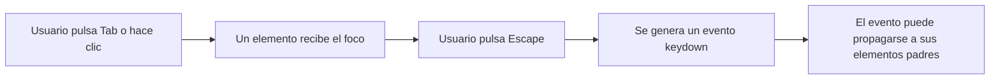
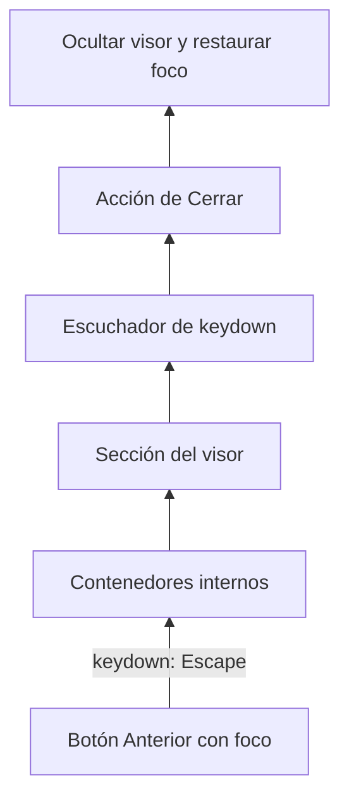
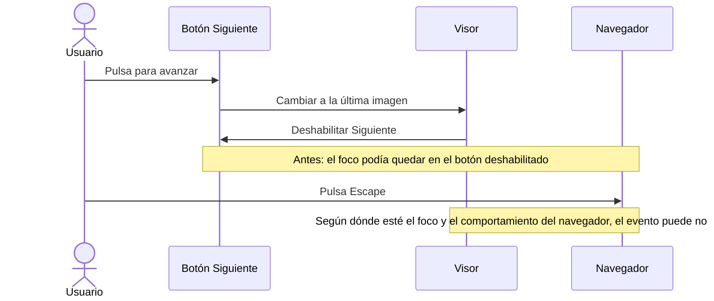
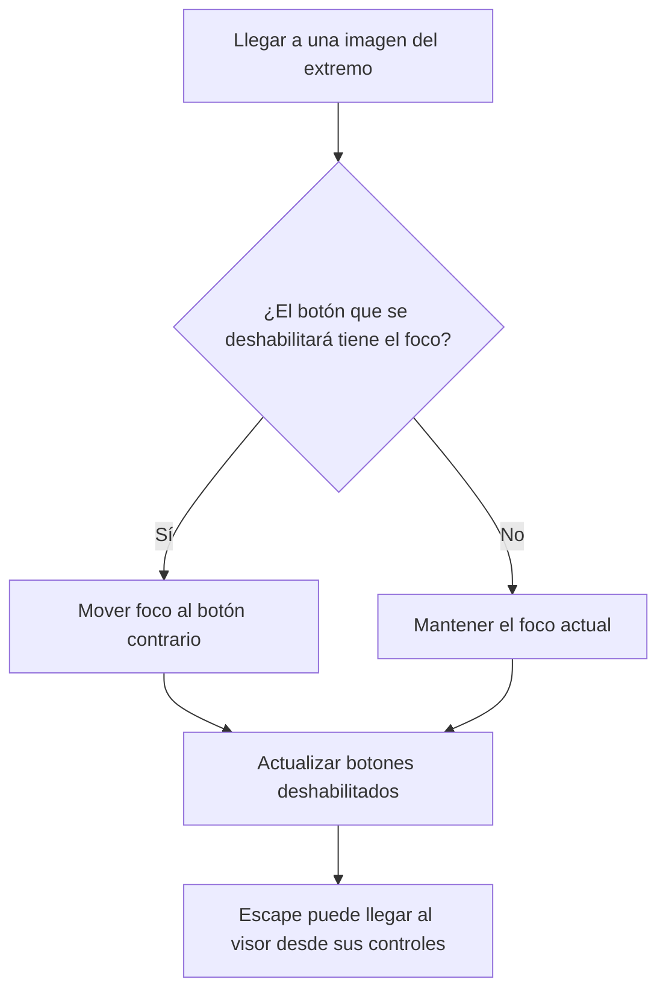

# Por qué Escape puede dejar de cerrar el visor

> [!abstract] Resumen
> El visor escucha las teclas dentro de su propio elemento. Al llegar a la última imagen, el botón **Siguiente** se deshabilita. Si ese botón tenía el foco, el navegador puede dejar el foco en un control que ya no es interactivo o desplazarlo fuera del visor. Eso puede impedir que el evento de Escape llegue al código que cierra el visor. La corrección mueve el foco a **Anterior** antes de deshabilitar **Siguiente**.
>
> **Importante:** esto explica un mecanismo plausible, no una causa demostrada en tu navegador. En el Chromium de prueba, Escape seguía funcionando con el botón deshabilitado enfocado. Lo que sí comprobamos es que el foco quedaba en ese botón; ahora la prueba exige que se mueva a un control habilitado.

## 1. ¿Qué es el foco?

El **foco** indica qué elemento recibe normalmente las acciones del teclado. Por ejemplo, al usar `Tab` puedes pasar de un botón a otro; si pulsas `Enter`, se activa el botón enfocado. Una pulsación como `Escape` genera un evento de teclado asociado al elemento enfocado.

El foco y el cursor del ratón son cosas distintas: mover el ratón sobre un botón no necesariamente le da foco. Hacer clic en un botón normalmente sí puede darle foco, aunque hay diferencias entre navegadores y plataformas.



En JavaScript puedes consultar el foco con:

```js
console.log(document.activeElement);
```

No confundirlo con `:hover`, que indica que el puntero está sobre un elemento, ni con el elemento que tiene una apariencia resaltada por otra razón.

## 2. ¿Cómo recibe Escape el visor?

El visor registra un **escuchador de eventos** en su contenedor, llamado `dialog` en el código. No es un `<dialog>` nativo: es una sección que funciona como panel del visor.

Fragmento simplificado de `src/scripts/image-viewer.mjs`:

```js
dialog.addEventListener('keydown', event => {
  if (event.key === 'Escape') {
    find('[data-viewer-close]').click();
    return;
  }

  // Otros atajos, como las flechas y el zoom.
});
```

Cuando el evento nace en un control dentro del visor y se propaga hacia sus padres, alcanza ese escuchador. Esto se conoce como **propagación por burbujeo** (*event bubbling*). El controlador activa el botón de cierre, que oculta el visor y devuelve el foco al elemento desde el que se abrió, si sigue disponible.



Si el evento se origina fuera de la sección del visor, no burbujea **hacia abajo** para entrar en ella. Por eso, que el foco permanezca en un control utilizable del visor es relevante para este diseño.

## 3. ¿Qué pasaba al llegar al final?

La galería deshabilita los botones cuando no hay más imágenes en esa dirección:

- En la primera imagen, **Anterior** queda deshabilitado.
- En la última imagen, **Siguiente** queda deshabilitado.

Esto evita acciones inválidas, pero crea un caso especial si el botón que se va a deshabilitar tiene el foco.



### Lo que sabemos y lo que no

| Evidencia | Conclusión |
|---|---|
| Reportaste que Escape dejó de cerrar el visor al llegar al final. | Existió un problema en tu interacción; tu captura muestra la última imagen y **Siguiente** deshabilitado. |
| En Chromium, el botón deshabilitado conservó el foco. | Se confirmó un estado de foco que conviene evitar. |
| En ese mismo Chromium, Escape sí cerró el visor antes del ajuste. | No se reprodujo exactamente el fallo reportado. |
| Después del ajuste, la prueba comprobó foco en **Anterior**, cierre con Escape y retorno del foco al elemento de apertura. | La corrección evita el estado de foco observado en esa prueba. |

> [!warning] No extrapolar de más
> No podemos afirmar que el botón deshabilitado fuera la única causa en tu navegador ni que todos los navegadores manejen el foco y los eventos de forma idéntica. Para confirmarlo en tu entorno habría que repetir la secuencia allí e inspeccionar `document.activeElement` y el destino del evento.

## 4. La corrección: mover el foco antes

El cambio está en `src/scripts/image-viewer.mjs`, dentro de `showImage()`:

```js
if (index === 0 && root.activeElement === previous) next.focus();
if (index === gallery.length - 1 && root.activeElement === next) previous.focus();
previous.disabled = index === 0;
next.disabled = index === gallery.length - 1;
```

La secuencia importa:

1. Se comprueba si estamos llegando a un extremo y si el control que se va a deshabilitar tiene el foco.
2. Si es así, se mueve el foco al botón de navegación contrario.
3. Después se actualizan los estados `disabled`.
4. Escape sigue llegando al escuchador del visor cuando se pulsa desde ese control.

Cuando se entra a una galería de una sola imagen, ninguno de los dos botones necesita recibir el foco: al abrir el visor, el foco va al botón **Cerrar**. La comprobación solo mueve el foco si este ya estaba en el botón que se deshabilita.



> [!note] Alcance de la solución
> Esta corrección protege la transición de foco en los extremos. No convierte Escape en un atajo global: si el foco está fuera del visor, el escuchador del visor no recibe necesariamente ese evento.

## 5. ¿Por qué aparecen errores de este tipo?

Suelen surgir cuando se mezclan varias piezas que funcionan bien por separado:

1. **Estado de la aplicación:** el índice llega al principio o al final.
2. **Estado del control:** un botón pasa de habilitado a deshabilitado.
3. **Estado del navegador:** el foco puede seguir en ese botón o cambiar.
4. **Enrutamiento del evento:** el escuchador solo recibe eventos que le llegan por la jerarquía del DOM.
5. **Interacción real:** ratón, teclado, tecnología asistiva y navegador pueden seguir rutas diferentes.

La interfaz puede verse correcta —la imagen y el contador son correctos— mientras el estado del foco deja de ser útil. Por eso no basta con comprobar solo la apariencia visual.

## 6. Cómo investigarlo en el navegador

Con el visor abierto, abre las herramientas de desarrollo y ejecuta:

```js
// Elemento que tiene el foco en este momento.
document.activeElement
```

Para observar dónde se origina un evento de teclado, puedes registrar temporalmente un escuchador y retirarlo al terminar:

```js
const observarTeclas = event => {
  console.log('Tecla:', event.key);
  console.log('Destino:', event.target);
  console.log('Foco actual:', document.activeElement);
};

document.addEventListener('keydown', observarTeclas);

// Después de probar:
// document.removeEventListener('keydown', observarTeclas);
```

Prueba la secuencia: abre una galería con varias imágenes, usa **Siguiente** hasta el final, consulta el foco y pulsa `Escape`. Después repite desde la segunda imagen hacia la primera con **Anterior**. También es útil comparar la navegación con ratón y con teclado.

## 7. Cómo lo comprobamos en el proyecto

La prueba de navegador en `tests/image-viewer.browser.js` comprueba que:

- Al alcanzar la última imagen, **Siguiente** está deshabilitado.
- El foco pasa a **Anterior**, que sigue habilitado.
- `Escape` cierra el visor.
- El foco vuelve al enlace que abrió la galería.

Además, se ejecutaron las demás pruebas del visor, las pruebas unitarias y `pnpm build`. La prueba del traslado de foco falló antes de la corrección y pasó después; la falla exacta de Escape no se reprodujo en el Chromium disponible.

## Ideas clave para recordar

- El **foco** determina dónde empieza normalmente la interacción de teclado.
- Un evento puede subir por la jerarquía del DOM; un escuchador de un panel no recibe automáticamente eventos originados fuera de él.
- Cambiar `disabled`, ocultar o retirar un elemento enfocado requiere pensar qué ocurrirá con el foco.
- Probar el **resultado** y también el **foco** ayuda a detectar problemas de teclado y accesibilidad.
- Una hipótesis razonable no es lo mismo que una causa confirmada: conviene conservar esa distinción al diagnosticar.
